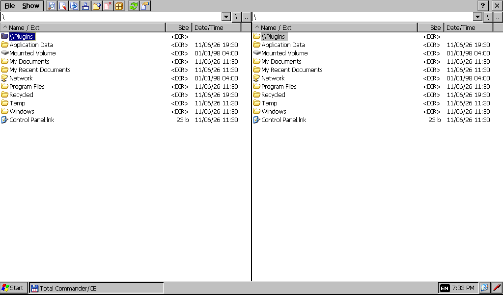

# Emulating the 4NSF (Windows CE) in QEMU

This folder boots a Windows Embedded Compact 7 ARM virtual machine in QEMU
and can load the complete VW "maps + more" software (Navigon 7.16.9, OS
2.33) into it from Volkswagen's own update package. Nothing from the device
or the package is committed to git; the scripts rebuild everything into
`Emulator/work/`.



## What the real device is

| Item | Value |
|---|---|
| Device | Garmin 4NSF / Navigon 70 series / VW, Seat, Skoda PID ("maps + more") |
| SoC | STMicroelectronics Cartesio+ STA2064 (ARM1176 core, integrated GPS) |
| RAM / flash | 128 MB / 4 GB |
| OS | Windows CE 6.0, OS image version 2.33, Navigon MobileNavigator 7.16.9 build 314 |
| App binaries | PE32 for Windows CE, ARM Thumb, subsystem 9 |

QEMU has no machine model for the STA2064, so the device's own `NK.nb0`
(kernel plus Cartesio drivers for display, NAND, GPS, CAN, USB) cannot be
booted as-is. The approach here is the other way round: run a generic
Compact 7 image on QEMU's `vexpress-a15` board and move the device's
user-mode software onto it.

## Quick start

Requirements (Debian/Ubuntu): `apt install qemu-system-arm curl unzip dosfstools mtools python3`.
No root is needed anywhere.

```sh
Emulator/run-emulator.sh                 # generic CE 7 VM, Apps/ attached as a disk
Emulator/run-emulator.sh --headless      # same, VNC on 127.0.0.1:5901

Emulator/build-navigon.sh                # ~1 min after the 3.5 GB download
Emulator/run-emulator.sh --navigon       # VM with the whole \My Flash Disk tree
```

`run-emulator.sh` downloads the prebuilt Compact 7 image from
[Milek7/wince-qemu](https://github.com/Milek7/wince-qemu) (SHA-256 checked),
builds a FAT32 disk and starts QEMU. The disk shows up in the guest as
`\Mounted Volume` (generic mode) or `\My Flash Disk` (`--navigon`). Boot takes
about a minute. Kernel debug output goes to `work/serial.log`; in headless
mode a QEMU monitor socket is at `work/mon.sock`.

To start a program in the guest use **Start > Run...** with a quoted path:

```
"\Mounted Volume\Apps\TotalCommander\tc.exe"
"\My Flash Disk\MortScript.exe" "\My Flash Disk\emu_start.mscr"
```

## Where the Navigon software comes from

Volkswagen still hosts the Garmin-labelled PID update at
`https://navigation-maps.volkswagen.com/vw-maps/Central_Europe.zip`
(3.5 GB, May 2022; other regions come through the myVolkswagen portal with
an Up! VIN). `build-navigon.sh` downloads it and verifies the package's own
MD5 list. It contains:

| File | What it is |
|---|---|
| `Install_OS.exe` | ExtractorCE self-extractor with the OS: `NK.nb0` (25 MB Windows CE ROM), `ApLoader.bin`, `xL_CPlus.bin`, `Meminit.bin`, `LPHandle.bin`, boot `config.txt`, splash screens |
| `UpdateMeContent.content` | Same container, 769 files: the `\My Flash Disk` tree (VwUserShell, VwBrandDevice, NAVIGON, BT, MediaPlayer, PictureViewer, Apps, watchdog configs, maps) |
| `Install_BT.exe`, `FullInstaller.exe`, `autorunce.mscr` | Bluetooth firmware and the SD-card installer chain |

The install guide says the package is only for units with the GARMIN label on
the back. The emulator never flashes anything, it only unpacks files.

## Tools in this folder

| Script | Purpose |
|---|---|
| `sfx_extract.py` | Unpacks the ExtractorCE `!NAVIGON_SFX!` archives (format documented in the file) with per-file MD5 check |
| `ceromdump.py` | Dumps a Windows CE ROM image: rebuilds every XIP module as a loadable PE file, copies the ROM files, flags compressed ones |
| `celzx.py` | Decompresses ROM-compressed files (24-bit block table, 4 KB LZX blocks); verified byte-exact against a copy of the same DLL on the flash disk |
| `patch_image.py` | Renames the Compact 7 image's disk mount from `Mounted Volume` to `My Flash Disk`; `--display 480x272` rewrites the OAL's hardcoded 1024x600 mode and PL111 timings |
| `cestub.py` | `make-stub` builds an ARM CE DLL without a toolchain: exports returning a value, copying a string, or serving a file-backed blob (used for `WolfSpecial.dll` with an emulated hidden flash and for a whole stub `HWLHardwareLayer.dll`); `patch` rewrites a PE's import table so symbols the target image lacks come from the stub, and can rename import DLLs |
| `guest-tools/` | Hand-assembled CE test programs (sockets, timers, GDI, window list, thread stacks, app launchers) and their generators, copied to the disk's `0emu` folder |
| `mkdisk.py` | MBR + FAT32 disk image from folders, using mtools |
| `emu_start.mscr` | MortScript for the guest: registry setup from the device's `autorunce.mscr`, then the application chain from `Watchdog_HW.ini`. MortScript itself runs in the VM, but this script has not yet been seen to start the chain; the three Run commands below are the verified route |

`cestub.py patch` found only 16 coredll functions (RAS and TAPI used by
`BTCore.exe` and `navigon.exe`, `GetSystemPowerStatusEx` used by every
hardware-layer DLL) and one DLL (`svoxdll.dll`) that the Compact 7 image lacks.
The device ROM's own DLLs that the apps load at run time (`WolfSpecial.dll`,
`nfVR.dll`, `openGL_ES_STA2065.dll`, MFC 9.0, fonts) are copied next to each
executable.

## How far it runs

Verified in this repository's history, screenshots in this folder:

- Generic mode: Windows CE desktop, disk mounts, Total Commander/CE from `Apps` runs.
- Navigon mode: the image is patched to the device's 480x272 screen
  (`screenshot-480x272.png`) and the disk mounts as `\My Flash Disk`.
  `VwCommunicationExe.exe`, `VwBrandDevice.exe` and `VwUserShell.exe
  -ShowWindow=1` start, keep running, load every library, create their
  full-screen windows and sit in their message loops. The `0emu` folder on
  the disk holds shortcuts and test programs so all of this is mouse-driven.
- Not yet: neither the brand app nor the shell ever draws. Their windows are
  visible but never blitted into, so the Explorer underneath shows through
  and swallows clicks.

What has been ruled out, each with a test in `guest-tools/`:

| Suspect | Result |
|---|---|
| Hardware layer (`HWLHardwareLayer.dll`, `WolfSpecial.dll`, hidden flash, `GMD1:`/`HFC1:`/`WDT1:`/`BKL1:` drivers) | Replacing the whole hardware layer with a stub (`HWL_STUB=1`) changes nothing. `ReadHiddenFlash` is served from `work/hidden_flash.bin`. |
| TCP/IP and the legacy `WINSOCK.dll` the apps use | `socktest.exe`: socket, bind, listen, connect, accept, send, recv on 127.0.0.1 all work. |
| Multimedia timer | `timertest7.exe`: periodic callbacks fire. The shell's crash in `timeKillEvent` (null pointer in the image's mmtimer.dll) only happens on its way out. |
| GDI | `gditest.exe`: a 16 bpp DIB section blits into a popup window exactly as the apps do. |
| Screen size (`R480x272` skins) | Image patched to 480x272. Windows become 480x272, still nothing drawn. |
| `\MN Settings`, `\Storage Card`, COM port, DevMode VIN, empty `BrandDevice.reg` | No change. |
| Blocked threads | `stacks.exe`: main threads idle in `GetMessageW`, AppCom thread in `recvfrom`, a timer thread in mmtimer; nothing spins. The window procedure only calls `BeginPaint`/`EndPaint`; drawing happens from the apps' own engine, which never starts. |

The device ROM's own modules cannot be transplanted: ROM modules are stored
pre-relocated without fixups, so the CE 6 `mmtimer.dll` loaded at a new
address corrupted its neighbour (`wspm.dll`) and crashed the shell.

## Next steps for a working UI

1. **AppCom.** The apps talk to each other with Navigon's AppCom (UDP on
   127.0.0.1, ports in `NgAppCom.xml`). The brand app most likely waits for
   vehicle data from `VwCommunicationExe`, which waits for the car's BAP
   protocol on COM1 (`VwCommunicationManager.ini`, `ComPort=1` in the shim
   copy). Feeding a BAP "no vehicle"/ignition sequence into QEMU's second
   serial port, or sniffing AppCom with a small UDP tool on the disk, is the
   most promising lead. AppCom has a logging switch (`AppComLogging`,
   `AppComLogfilePath` strings in `ACAppCom.dll`) that this session could not
   trigger from `NgAppCom.xml`.
2. **Hidden flash contents.** Dump the real unit's 2 KB hidden flash (through
   `WolfSpecial.dll` `ReadHiddenFlash` on the device) into
   `work/hidden_flash.bin` so brand, VIN pairing and serial are genuine.
3. **GPS.** Once `navigon.exe` runs, feed NMEA from `gpsfake` into QEMU's
   `-serial` for `COM1:`.
4. **Map licence.** Maps are keyed to the device serial from the OEM layer.

## Files that stay out of git

`Emulator/work/` is ignored. It holds the Compact 7 image, the VW package,
its unpacked trees, the ROM dump and the disk images (about 20 GB in total).
