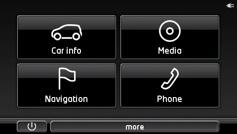
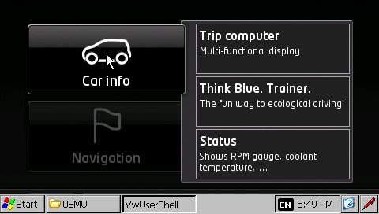
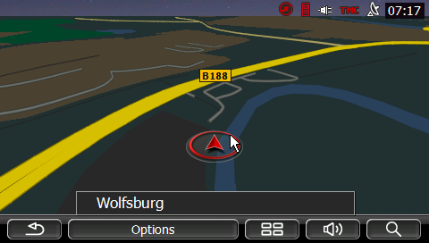
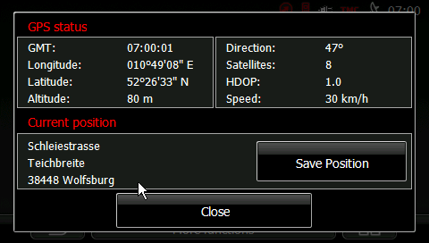

# Emulating the 4NSF (Windows CE) in QEMU

This folder boots a Windows Embedded Compact 7 ARM virtual machine in QEMU
and can load the complete VW "maps + more" software (Navigon 7.16.9, OS
2.33) into it from Volkswagen's own update package. Nothing from the device
or the package is committed to git; the scripts rebuild everything into
`Emulator/work/`.



## What the real device is

| Item | Value |
|---|---|
| Device | Garmin 4NSF / Navigon 70 series / VW, Seat, Skoda PID ("maps + more") |
| SoC | STMicroelectronics Cartesio+ STA2064 (ARM1176 core, integrated GPS) |
| RAM / flash | 128 MB / 4 GB |
| OS | Windows CE 6.0, OS image version 2.33, Navigon MobileNavigator 7.16.9 build 314 |
| App binaries | PE32 for Windows CE, ARM Thumb, subsystem 9 |

QEMU has no machine model for the STA2064, so the device's own `NK.nb0`
(kernel plus Cartesio drivers for display, NAND, GPS, CAN, USB) cannot be
booted as-is. The approach here is the other way round: run a generic
Compact 7 image on QEMU's `vexpress-a15` board and move the device's
user-mode software onto it.

## Quick start

Requirements (Debian/Ubuntu): `apt install qemu-system-arm curl unzip dosfstools mtools python3`.
No root is needed anywhere.

```sh
Emulator/run-emulator.sh                 # generic CE 7 VM, Apps/ attached as a disk
Emulator/run-emulator.sh --headless      # same, VNC on 127.0.0.1:5901

Emulator/build-navigon.sh                # ~1 min after the 3.5 GB download
Emulator/run-emulator.sh --navigon       # VM with the whole \My Flash Disk tree
```

`run-emulator.sh` downloads the prebuilt Compact 7 image from
[Milek7/wince-qemu](https://github.com/Milek7/wince-qemu) (SHA-256 checked),
builds a FAT32 disk and starts QEMU. The disk shows up in the guest as
`\Mounted Volume` (generic mode) or `\My Flash Disk` (`--navigon`). Boot takes
about a minute. Kernel debug output goes to `work/serial.log`; in headless
mode a QEMU monitor socket is at `work/mon.sock`.

To start a program in the guest use **Start > Run...** with a quoted path:

```
"\Mounted Volume\Apps\TotalCommander\tc.exe"
"\My Flash Disk\MortScript.exe" "\My Flash Disk\emu_start.mscr"
```

In `--navigon` mode open `\My Flash Disk\0emu` in the Explorer window and
double-click `launch-all.exe`: it starts `VwCommunicationExe`, `VwBrandDevice`
and `VwUserShell` with the device's command lines and the VW main menu
appears after about a minute. Headless, the same with the mouse over VNC:

```sh
pip install vncdotool pillow
Emulator/tools/nmea.py --speed 30 --heading 45 &          # GPS receiver on COM1:
Emulator/tools/vnc.py 0emu dbl 188 143 60 shot menu      # menu.png = the shell
Emulator/tools/vnc.py click 135 170 20 shot navigon      # Navigation tile
```

Navigon's first start asks for language, units and the EULA (six dialogs,
first option + OK each); the map is under More functions > Show map.

## Where the Navigon software comes from

Volkswagen still hosts the Garmin-labelled PID update at
`https://navigation-maps.volkswagen.com/vw-maps/Central_Europe.zip`
(3.5 GB, May 2022; other regions come through the myVolkswagen portal with
an Up! VIN). `build-navigon.sh` downloads it and verifies the package's own
MD5 list. It contains:

| File | What it is |
|---|---|
| `Install_OS.exe` | ExtractorCE self-extractor with the OS: `NK.nb0` (25 MB Windows CE ROM), `ApLoader.bin`, `xL_CPlus.bin`, `Meminit.bin`, `LPHandle.bin`, boot `config.txt`, splash screens |
| `UpdateMeContent.content` | Same container, 769 files: the `\My Flash Disk` tree (VwUserShell, VwBrandDevice, NAVIGON, BT, MediaPlayer, PictureViewer, Apps, watchdog configs, maps) |
| `Install_BT.exe`, `FullInstaller.exe`, `autorunce.mscr` | Bluetooth firmware and the SD-card installer chain |

The install guide says the package is only for units with the GARMIN label on
the back. The emulator never flashes anything, it only unpacks files.

## Tools in this folder

| Script | Purpose |
|---|---|
| `sfx_extract.py` | Unpacks the ExtractorCE `!NAVIGON_SFX!` archives (format documented in the file) with per-file MD5 check |
| `ceromdump.py` | Dumps a Windows CE ROM image: rebuilds every XIP module as a loadable PE file, copies the ROM files, flags compressed ones |
| `celzx.py` | Decompresses ROM-compressed files (24-bit block table, 4 KB LZX blocks); verified byte-exact against a copy of the same DLL on the flash disk |
| `patch_image.py` | Renames the Compact 7 image's disk mount from `Mounted Volume` to `My Flash Disk`; `--display 480x272` rewrites the OAL's hardcoded 1024x600 mode and PL111 timings; guards the image's `mmtimer.dll` against `timeKillEvent` before `timeSetEvent` (see below) |
| `cestub.py` | `make-stub` builds an ARM CE DLL without a toolchain: exports returning a value, copying a string, or serving a file-backed blob (used for `WolfSpecial.dll` with an emulated hidden flash and for a whole stub `HWLHardwareLayer.dll`); `patch` rewrites a PE's import table so symbols the target image lacks come from the stub, and can rename import DLLs |
| `guest-tools/` | Hand-assembled CE test programs (sockets, timers, GDI, window list, thread stacks, app launchers) and their generators, copied to the disk's `0emu` folder |
| `mkflash.py` | Writes the emulated 2 KB hidden flash: validity signature, brand, "paired" flag and VIN in the layout the VW apps read (documented in the file). `VIN=... build-navigon.sh` sets your own VIN |
| `tools/` | Host-side debugging: mouse-driven VNC control, a Windows CE API tracer on QEMU's gdbstub, and disassembly/call-graph helpers for the ARM binaries (see `tools/README.md`) |
| `mkdisk.py` | MBR + FAT32 disk image from folders, using mtools |
| `emu_start.mscr` | MortScript for the guest: registry setup from the device's `autorunce.mscr`, then the application chain from `Watchdog_HW.ini`. MortScript itself runs in the VM, but this script has not yet been seen to start the chain; the three Run commands below are the verified route |

`cestub.py patch` found only 16 coredll functions (RAS and TAPI used by
`BTCore.exe` and `navigon.exe`, `GetSystemPowerStatusEx` used by every
hardware-layer DLL) and one DLL (`svoxdll.dll`) that the Compact 7 image lacks.
`GetSystemPowerStatusEx` is the one stub that must do work: it fills the
caller's 24-byte `SYSTEM_POWER_STATUS_EX` with "AC on-line, battery full"
(anything larger overruns the caller's stack frame). The device ROM's own
DLLs that the apps load at run time (`WolfSpecial.dll`, `nfVR.dll`,
`openGL_ES_STA2065.dll`, MFC 9.0, fonts) are copied next to each executable.

## How far it runs



- Generic mode: Windows CE desktop, disk mounts, Total Commander/CE from `Apps` runs.
- Navigon mode: the image runs at the device's 480x272 and the disk mounts as
  `\My Flash Disk`. `VwCommunicationExe`, `VwBrandDevice` and `VwUserShell`
  start as on the device, the brand app accepts the emulated hidden flash as
  "paired with a Volkswagen" and exits, and **the VW main menu comes up**
  (`screenshot-vw-shell.png`): Car info, Media, Navigation, Phone. The Car
  info submenu (Trip computer, Think Blue. Trainer, Status) opens, Phone
  starts `PhoneApplication.exe`, which draws its own UI ("no device
  connected") in German.
- **Navigation starts Navigon MobileNavigator 7** (`screenshot-navigon-menu.png`):
  the first-start wizard (language, units, time and date format, EULA), the
  main menu (New destination, My destinations, Take me home, Voice command),
  More functions, Settings and **the map** work. `tools/nmea.py` is the GPS
  receiver: GPS status shows the fix, the position is reverse-geocoded from
  the map data ("Schleiestrasse, 38448 Wolfsburg") and the car moves on the
  3D map (`screenshot-navigon-map.png`). The shell's status bar picks up
  Navigon's state over AppCom. Phone starts `BTCore.exe` and asks to search
  for Bluetooth devices; Media is started hidden by the shell
  (`MediaPlayer.exe -Mode=NOCONN`).
- Not yet: vehicle data (Car info shows no values), Bluetooth and media
  playback; the GL ES renderer (the map uses Navigon's software renderer, see
  below); TMC and voice recognition are untested.




### What it took

1. **Pairing.** Without a car the brand app shows "Connect your device to
   your brand new car and switch the ignition on"
   (`screenshot-vw-pairing.png`) and waits for the car's BAP identification.
   The forum recipe (empty `BrandDevice.reg` plus a
   `UserSettingsDevMode.default` with a VIN) does not get past it here. The
   decision is made from the 2 KB hidden flash, read through
   `WolfSpecial.dll`: byte `0x30` must be `'B'` and byte `0x2f` a known
   brand (0 VW, 2 Seat, 3 Skoda), with the signature `123Kuckuck123` at
   `0x10`, the VIN at `0x1e` and `0x36`, and sound/type/line/class bytes at
   `0x32..0x35` (brand 0 + sound 2 selects the "Fender" splash screen).
   `mkflash.py` writes exactly that; the layout was recovered from every
   `ReadFlash`/`WriteFlash` call site in `VwBrandDevice.exe` and
   `VwUserShell.exe` with `tools/callers.py`. On the device `BrandDevice.reg`
   is a settings store the brand app migrates into the hidden flash once,
   which is why an empty file "resets" the pairing there.
2. **The shell's exit.** `VwUserShell.exe` died a few seconds after start with
   `PC=0 RA=mmtimer.dll+0x1b78`. The API trace (`tools/trace.gdb.py`) showed
   a `timeKillEvent` with a garbage id and no `timeSetEvent` before it: the
   shell's timer class leaves its second timer id uninitialised and the
   destructor kills it anyway. The device's CE 6 `mmtimer.dll` returns an
   error; the Compact 7 one calls a lock function pointer that only
   `timeInit` (run from `timeSetEvent`) sets. `patch_image.py` now routes
   `timeKillEvent` through a 7-word stub in the section's padding that
   returns `MMSYSERR_INVALPARAM` until mmtimer is initialised.
3. **Power status.** Every hardware-layer DLL polls `GetSystemPowerStatusEx`,
   which the image lacks; the stub fills a plausible 24-byte struct.
4. **Splash.** After pairing the brand app runs `SplashAnimation.exe`, which
   needs the Cartesio graphics accelerator (`sgalib.dll`, SGA ioctls); it is
   renamed away on the emulator disk.
5. **DirectDraw.** `navigon.exe` imports `openGL_ES_STA2065.dll` from the
   device ROM, which imports `DirectDrawCreate` from a `ddraw.dll` the Compact
   7 image does not have (`tools/depcheck.py` finds such gaps statically). A
   stub `ddraw.dll` whose `DirectDrawCreate` fails is enough for the DLL to
   load and the application to run.
6. **Map renderer.** With the GL ES DLL loaded but no accelerator
   (`G4M_InitMemory: Error`) "Show map" crashed `navigon.exe` in `memcpy`,
   with the real DLL and with a stub of all 190 exports alike. Navigon still
   carries its older eGML software map drawer (`DrawingSurfaceImplEGML`):
   `<OldMapDrawer>1</OldMapDrawer>` in `UserSettings.default` selects it and
   the map draws, 3D view included. `OLD_MAP_DRAWER=0` restores the device
   setting for anyone emulating the GL ES side.
7. **Taskbar.** The Explorer taskbar covered the bottom 26 pixels, exactly
   where the VW apps and Navigon put their button bars. `launch-all.exe`
   hides it (`FindWindow("HHTaskBar")` + `ShowWindow(SW_HIDE)`) before
   starting the apps.
8. **A self-inflicted one.** `BTCore.exe` failed with "Unable to import
   library MAPBL.dll": the package ships a newer `BT\MAPBL.dll` than the ROM,
   and the build script's copy of ROM DLLs next to each executable had
   overwritten it through the hard link into the pristine tree. The copy is
   `cp -n` now and the extracted tree is re-verified against `content.md5`.
   `guest-tools/loadtest.exe` (LoadLibrary + GetLastError from inside the
   guest) is what showed the DLL itself loads fine.

Verified not to matter (tests in `guest-tools/`): TCP/IP and the legacy
`WINSOCK.dll`, multimedia timers once initialised, GDI DIB blits, the whole
hardware layer (`HWL_STUB=1` behaves the same as the real DLL on the stubbed
`WolfSpecial.dll`). ROM modules of the device image cannot be transplanted:
they are stored pre-relocated without fixups.

## Next steps

1. **GL ES map renderer.** The device draws the map through GL ES 1.x on the
   Cartesio SGA; the emulator uses Navigon's software drawer. A software GL
   ES 1.1 for CE ARM behind the same 190 exports (Vincent 3D was written for
   exactly this platform) would bring the device's renderer back; it needs a
   CE cross-compiler (cegcc / mingw32ce).
2. **GPS routes.** `tools/nmea.py` moves the car along a heading; replaying
   a recorded NMEA log (or `gpsfake`) into port 5555 gives real drives.
3. **Vehicle data.** `VwCommunicationExe` reads the car's BAP link from
   `COM9:` on the device; the image has a single serial port and that one is
   the GPS now. Adding a second pl011 instance to the image's registry (the
   vexpress board has four UARTs) and feeding BAP frames there, or writing into the
   `VwSharedMemoryFileMapping` the shell reads (mutexes
   `MessageFzgIdentMutex`, `MessageBsg3Mutex`, ... `BapAllMutex`), would light
   up Car info with speed, RPM, fuel and the trip computer. The user manual
   (`UserManualUK.pdf` from Garmin's VW support site) lists what the device
   shows.
4. **Full screen.** Hide the Explorer taskbar (registry `HKLM\Software\
   Microsoft\Shell` or let the watchdog/`autorunce.mscr` replace the shell) so
   the apps get the full 480x272 like on the device.
5. **Hidden flash of a real unit.** Dump it through `WolfSpecial.dll`
   `ReadHiddenFlash` on the device into `work/hidden_flash.bin` so brand, VIN
   and serial are genuine (maps are keyed to the device serial).

## Files that stay out of git

`Emulator/work/` is ignored. It holds the Compact 7 image, the VW package,
its unpacked trees, the ROM dump and the disk images (about 20 GB in total).
