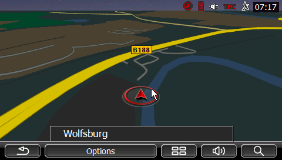

# 4NSF toolbox
Welcome to the Toolbox for the Garmin 4NSF, also known as Navigon 70/71 and VW/Seat/Skoda PID! Here you'll find a collection of applications, tools and information designed for customization and troubleshooting of your device. Feel free to explore!


This repository is there to add some extra flair to your GarminNavigon device, but it's essential to tread carefully. Messing around with the operating system or other files could potentially lead to unintentional mishaps, and nobody wants a bricked device. So, have fun exploring the enhanced features, but proceed with caution. Make sure you've backed up your device before diving into the exciting world of customization. If you're unsure about anything, feel free to reach out via the [Issues section](https://github.com/jilleb/4nsf-toolbox/issues). Happy tinkering, and may your device stay as lively as ever!

## Emulator

Want to try the device's software, or your own, without a device? The [Emulator](Emulator/README.md) folder boots a Windows Embedded Compact ARM virtual machine in QEMU and can load the complete VW "maps + more" software into it from Volkswagen's own update package: the VW shell, Navigon MobileNavigator with a working map and an emulated GPS receiver, and the phone app. Nothing from the device or the package is committed; the scripts rebuild everything.



```sh
Emulator/run-emulator.sh            # generic CE VM with the Apps folder attached
Emulator/build-navigon.sh           # one-time: download the VW package, build the disk
Emulator/run-emulator.sh --navigon  # the full VW environment
```

The [Devkit](Devkit/README.md) folder adds a Windows CE cross-compiler (CeGCC, Docker image or native), C and C++ samples, and a deploy agent so your own programs reach the emulator or a device with one command.

The folder also documents what was needed to get there (hidden-flash pairing, loader and timer quirks, the software map renderer) and ships the tooling used: a mouse-driven VNC controller, an NMEA GPS feeder, a Windows CE API tracer on QEMU's gdbstub, PE patching and stub-DLL generators, and small in-guest test programs. See [Emulator/README.md](Emulator/README.md) for the details and the current limits (no vehicle data, Bluetooth or GL ES yet).

## Apps

Additional apps add new features to the device. The following apps are available in the repository.

### How to install?
1. Connect your device to your computer via USB.
2. Open the device storage on your computer.
3. Copy the desired app folder from the "Apps" directory to the Apps folder in the main root of your Navigon device.
4. Safely eject your Navigon device from your computer.
5. Restart your device if necessary.
6. Find the new app in the Apps drawer of your device.

#### Explorer
Explorer is the Windows Explorer application that provides direct access to the operating system of your device. Easily navigate through files and folders to manage and organize your content. After starting the app, you will have a taskbar at the bottom of the screen, which you can use to start various apps and functions within Windows. This app isn't really a new app but a shortcut to the explorer.exe in the Windows folder.

#### GarminTestMode
GarminTestMode is a test application developed by Garmin. This application allows you to perform various tests on your device, ensuring its functionality and performance. This isn't really a new application but a shortcut to the garmintestmode.exe in the Windows folder.

#### VWPaint
VWPaint is a notepad application designed for quick and easy note-taking on your Navigon device. Jot down important information, reminders, or anything you need to remember on the go. This app was originally distributed with VW firmwares and wasn't included in Seat and Skoda distributions. 

#### TotalCommander
TotalCommander is a powerful file management application that provides a user-friendly interface for efficient file and folder operations. This specific version came from digital-eliteboard.com and is not developed by me, but I made a shortcut for it so it would work with the 4NSF menus. 

#### VWBeamlight
VWBeamlight is an app that adds a high beam animation to the screen of your device. This app was originally distributed with VW firmwares and wasn't included in Seat and Skoda distributions. 

